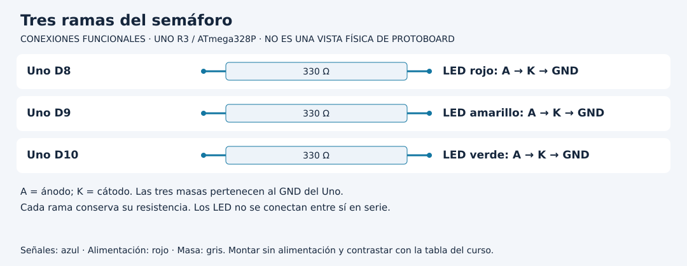

# Construir un semáforo desde una salida

[Unidad](README.md) · [Laboratorio](LABORATORIO.md) · [Soluciones](SOLUCIONES.md)

**Programas de referencia:** [semaforo_guiado](ejemplos/semaforo_guiado/semaforo_guiado.ino). Abre el archivo completo mientras sigues el desarrollo.

## Esquema de conexiones

Estos esquemas muestran terminales y recorridos eléctricos, no posiciones de una protoboard ni orientaciones universales de componentes. Contrasta las etiquetas con tu pieza y con [la tabla de conexiones](../docs/CONEXIONES.md).

## 1. Comienza con una rama

El montaje final tiene tres LED y tres resistencias de 330 Ω, una por LED. Cada resistencia limita su propia rama. Identifica ánodo y cátodo; utiliza la ficha si las patas fueron cortadas. D8 controla rojo, D9 amarillo y D10 verde. No confundas el orden de los pines con el orden temporal.

Primero comprueba una salida. En una copia de práctica conserva solo la inicialización de D8 y solicita HIGH. Cuando rojo funcione, desconecta alimentación y añade las otras dos ramas. Esta construcción evita buscar un error entre tres LED al mismo tiempo.

## 2. Un número representa una fase

`fase` toma 0, 1 y 2. El programa decide explícitamente qué significa cada valor:

| Fase | Rojo D8 | Verde D10 | Amarillo D9 | Duración |
|---:|---|---|---|---:|
| 0 | HIGH | LOW | LOW | 3000 ms |
| 1 | LOW | HIGH | LOW | 3000 ms |
| 2 | LOW | LOW | HIGH | 1000 ms |

En `mostrar`, cada comparación produce verdadero o falso. Al escribir las tres salidas, el estado anterior deja de depender de cuál LED estaba encendido. Las llamadas son consecutivas, no eléctricamente simultáneas; la tabla describe el estado estable después de completar la función.

## 3. Cómo avanza la secuencia

`fase = (fase + 1) % 3` suma una fase y conserva el resto de dividir entre tres. Para 0 da 1, para 1 da 2 y para 2 da 0. La variable `periodo` se calcula antes de decidir si avanza: el tiempo corresponde a la fase actual, no a la siguiente.

El arranque llama a `mostrar`, así que rojo aparece inmediatamente. Cerca de 3000 ms pasa a verde; a 6000, a amarillo; a 7000 vuelve a rojo. El ciclo nominal suma siete segundos.

## 4. Una ampliación que cambia el modelo

Para insertar una fase con todo apagado, no basta modificar `% 3` por `% 4`. Debes definir qué muestra fase 3 y cuánto dura. Escribe primero la cuarta fila de la tabla. Después modifica la transición, la selección de duración y el mensaje. Si olvidas un lugar, podrías tener una salida correcta con un mensaje incorrecto.

## 5. Diagnostica desde la tabla

Si una fase deja dos LED encendidos, revisa cada escritura y cada rama. Si los colores salen intercambiados, compara etiquetas físicas con constantes. Si un LED nunca enciende, apaga y revisa su orientación y resistencia antes de atribuirlo al temporizador. La práctica demuestra una secuencia de maqueta; no incorpora sensores de tráfico ni requisitos de un controlador vial real.

[Realizar el laboratorio](LABORATORIO.md) · [Contrastar las respuestas](SOLUCIONES.md) · [Volver a la unidad](README.md)
