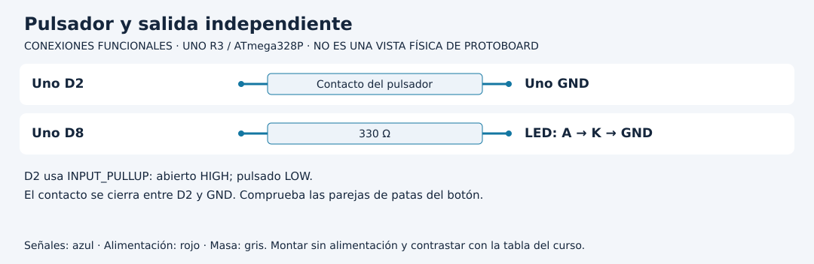

# Leer un botón sin multiplicar pulsaciones

[Unidad](README.md) · [Laboratorio](LABORATORIO.md) · [Soluciones](SOLUCIONES.md)

**Programas de referencia:** [boton_estable](ejemplos/boton_estable/boton_estable.ino). Abre el archivo completo mientras sigues el desarrollo.

## Esquema de conexiones

Estos esquemas muestran terminales y recorridos eléctricos, no posiciones de una protoboard ni orientaciones universales de componentes. Contrasta las etiquetas con tu pieza y con [la tabla de conexiones](../docs/CONEXIONES.md).

## 1. Del contacto al nivel eléctrico

Un pulsador conecta o separa dos puntos. La referencia usa D2 con `INPUT_PULLUP` y un contacto hacia GND. Al soltar, la resistencia interna mantiene HIGH. Al pulsar, el contacto lleva la entrada a LOW. Por tanto **pulsado no significa HIGH** en este montaje.

En un botón de cuatro patas suele haber parejas unidas internamente; comprueba su disposición. Si eliges dos patas de la misma pareja, la entrada parecerá siempre pulsada. El esquema representa un contacto, no una orientación universal de encapsulado.

## 2. Nivel y evento responden preguntas distintas

`digitalRead` responde qué nivel observa ahora. Un evento de pulsación responde cuándo se confirmó una nueva pulsación. Si invirtieras el LED en cada vuelta mientras D2 es LOW, una sola pulsación lo invertiría muchas veces. El número dependería de la velocidad del programa.

## 3. Abre el código que estabiliza

El sketch usa `Curso::Boton` desde `Logica.h`, archivo que viene junto al programa. `crudo` es el último nivel observado, `estable` el nivel ya aceptado y `cambio` el momento del último cambio crudo.

Cuando cambia el nivel, actualiza `cambio`. Solo acepta el nivel nuevo si permanece igual al menos 30 ms. Al aceptar LOW retorna true una vez; al aceptar HIGH actualiza el estado pero no emite pulsación.

| Instante del ejemplo | Lectura | Resultado |
|---:|---|---|
| 0 ms | LOW | Empieza a esperar |
| 10 ms | HIGH | Reinicia la espera por rebote |
| 20 ms | LOW | Comienza otra espera |
| 49 ms | LOW | Han pasado 29 ms: no acepta |
| 50 ms | LOW | Acepta LOW y emite un evento |
| 1000 ms | LOW | Sigue pulsado: no emite otro |

Después hace falta una liberación estable antes de que otra pulsación estable se reconozca. Un toque que no dura 30 ms puede descartarse: es una decisión explícita de este laboratorio.

## 4. Del evento a la salida

En el `if`, `salida = !salida` cambia la memoria del LED. `digitalWrite` la aplica. El botón no alimenta el LED: solicita un cambio que el programa procesa. Suelta y pulsa nuevamente; mantenerlo no debe repetir ON/OFF.

## 5. Experimento comparativo

Predice qué pasa si se reduce la estabilización a 5 ms en una copia del header. Comprueba varias pulsaciones y registra si aparecen cambios adicionales; no todos los botones rebotan igual. Restablece 30 ms. Un `delay(30)` no equivale a comprobar que el nivel permaneció estable: detiene el programa y por sí solo no registra la evolución durante esa pausa.

[Realizar el laboratorio](LABORATORIO.md) · [Contrastar las respuestas](SOLUCIONES.md) · [Volver a la unidad](README.md)
