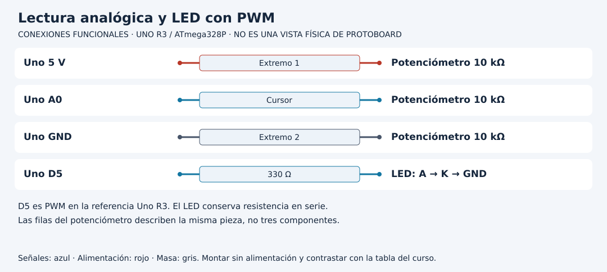

# Del ADC al tiempo encendido de un LED

[Unidad](README.md) · [Laboratorio](LABORATORIO.md) · [Soluciones](SOLUCIONES.md)

**Programas de referencia:** [brillo_pwm](ejemplos/brillo_pwm/brillo_pwm.ino). Abre el archivo completo mientras sigues el desarrollo.


## Esquema de conexiones

Estos esquemas muestran terminales y recorridos eléctricos, no posiciones de una protoboard ni orientaciones universales de componentes. Contrasta las etiquetas con tu pieza y con [la tabla de conexiones](../docs/CONEXIONES.md).




## 1. Leer y escribir no son operaciones inversas

`analogRead(A0)` obtiene un código de entrada de 0 a 1023. `analogWrite(D5, duty)` configura una salida PWM con un argumento de 0 a 255. El Uno R3 no convierte ese número en una tensión continua arbitraria: alterna niveles y cambia la fracción del tiempo en HIGH.

La resistencia de 330 Ω sigue siendo necesaria. PWM reduce el tiempo encendido, pero durante HIGH la rama necesita limitación de corriente. La entrada del potenciómetro y la salida del LED son dos circuitos unidos por la decisión del programa.

## 2. Abre la función de conversión

`Curso::pwmDesdeAdc` está en `Logica.h`. Limita valores mayores de 1023 y calcula `(uint32_t(raw) * 255) / 1023`. La conversión a 32 bits ocurre antes del producto. Evita un desbordamiento intermedio en la referencia AVR.

| ADC | PWM del programa | Interpretación aproximada |
|---:|---:|---|
| 0 | 0 | Apagado |
| 512 | 127 | Cerca de media escala de trabajo |
| 1023 | 255 | Encendido continuo |

512 produce 127 por truncamiento, no 128. Esta función define una escala de comandos; la percepción humana de brillo no tiene por qué variar linealmente con ella.

## 3. Sigue una muestra

Cada 100 ms el sketch obtiene `raw`, convierte a `duty`, escribe D5 y muestra ambos números. La frecuencia de actualización del control es aproximadamente diez veces por segundo; no es la frecuencia de la onda PWM. El temporizador genera los pulsos entre las vueltas de `loop`.

Observa el potenciómetro en mínimo, centro y máximo. Predice el comando antes de girar. No uses el multímetro como prueba de que la señal es continua: según el instrumento puede mostrar una media de una señal pulsada.

## 4. Limitar no es reescalar

Para limitar el máximo a 128 en una copia, añade antes de `analogWrite`:

```cpp
if (duty > 128) {
  duty = 128;
}
```

Eso satura la mitad superior: muchos valores del potenciómetro producen el mismo comando. Si quisieras aprovechar todo el recorrido entre 0 y 128, necesitarías otra conversión proporcional. Escribe primero cuál de los dos comportamientos deseas.

## 5. Cambiar el pin requiere revisar hardware

D5 tiene PWM en Uno R3. D8 no es un reemplazo equivalente. Usar un número de pin válido no implica que soporte la función esperada. Más adelante las bibliotecas de Servo y tono también usan temporizadores, de modo que integrar prácticas exige revisar recursos compartidos, además de pines.

[Realizar el laboratorio](LABORATORIO.md) · [Contrastar las respuestas](SOLUCIONES.md) · [Volver a la unidad](README.md)
