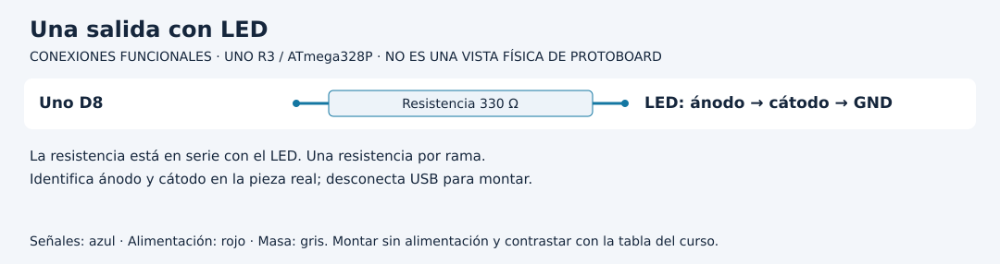

# Separar adquisición, decisión y representación

[Unidad](README.md) · [Laboratorio](LABORATORIO.md) · [Soluciones](SOLUCIONES.md)

**Programas de referencia:** [funciones_medicion](ejemplos/funciones_medicion/funciones_medicion.ino). Abre el archivo completo mientras sigues el desarrollo.

## Esquema de conexiones

Estos esquemas muestran terminales y recorridos eléctricos, no posiciones de una protoboard ni orientaciones universales de componentes. Contrasta las etiquetas con tu pieza y con [la tabla de conexiones](../docs/CONEXIONES.md).

## 1. Un problema pequeño que puede explicarse

Queremos encender un LED cuando el potenciómetro llegue a 600 cuentas o más. La entrada física sigue en A0 y el LED externo en D8, con resistencia. Esta decisión no representa todavía temperatura ni distancia: trabaja con un código ADC.

El programa divide el recorrido en tres funciones. `adquirir()` lee hardware y devuelve un entero. `decidir(int valor)` recibe un dato y devuelve un booleano. `representar(int valor, bool alerta)` actualiza el LED y el monitor. Separarlas permite hacer preguntas distintas sobre cada parte.

## 2. Sigue los argumentos

En una actualización se ejecuta `int valor = adquirir()`. Esa variable conserva una sola muestra. Después `decidir(valor)` evalúa la regla y su resultado se entrega a `representar` junto con la misma muestra. No se vuelve a medir dentro de la decisión.

| Muestra | Comparación | Resultado | LED |
|---:|---|---|---|
| 599 | 599 >= 600 | false | OFF |
| 600 | 600 >= 600 | true | ON |
| 601 | 601 >= 600 | true | ON |

La frontera 600 importa: usar `>` en vez de `>=` cambia el caso exacto. No basta probar solo 0 y 1023 para detectar esa diferencia.

## 3. Qué puede probarse sin sensor

La decisión no necesita leer A0. En una copia puedes imprimir `decidir(599)`, `decidir(600)` y `decidir(601)` dentro de `setup`, sin conectar potenciómetro. Comprobarás la regla, pero no el ADC. Si la regla pasa y el montaje falla, investiga adquisición y representación por separado.

Una función que llama a `digitalWrite` tiene un efecto sobre hardware. Una comparación que solo usa su argumento es más fácil de probar y reutilizar. No conviertas toda función en un bloque que lee sensores e imprime: perderías esa separación.

## 4. Construye una modificación

Cambia el umbral a 700 en una copia y actualiza primero la tabla de fronteras a 699, 700 y 701. Si la lógica sigue usando 600 en otro lugar, encontrarás decisiones inconsistentes. La constante `UMBRAL` evita repetir el número de negocio por todo el programa.

## 5. Cuando una sola frontera no alcanza

Una señal próxima a 600 puede alternar 599 y 601. La regla actual cambia el LED cada vez. Promediar puede suavizar, pero no define dos fronteras distintas. Para conservar encendido hasta bajar a 580 y activarlo solo al subir a 620, necesitas recordar el estado anterior. Esa es la histéresis que se desarrollará en los proyectos. La firma de una decisión sin memoria dejaría de describir todo lo que necesita la regla.

[Realizar el laboratorio](LABORATORIO.md) · [Contrastar las respuestas](SOLUCIONES.md) · [Volver a la unidad](README.md)
