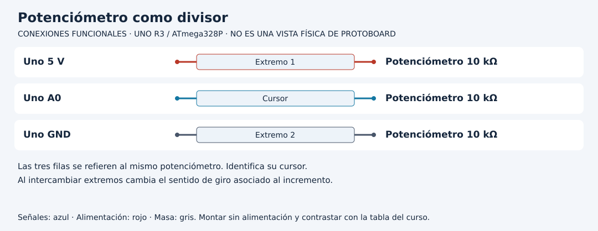

# Coordinar tareas sin confundirlas con hilos

[Unidad](README.md) · [Laboratorio](LABORATORIO.md) · [Soluciones](SOLUCIONES.md)

**Programas de referencia:** [dos_tareas](ejemplos/dos_tareas/dos_tareas.ino). Abre el archivo completo mientras sigues el desarrollo.

## Esquema de conexiones

Estos esquemas muestran terminales y recorridos eléctricos, no posiciones de una protoboard ni orientaciones universales de componentes. Contrasta las etiquetas con tu pieza y con [la tabla de conexiones](../docs/CONEXIONES.md).

## 1. Dos trabajos comparten loop

El programa alterna el LED incorporado cada 500 ms y lee A0 cada 200 ms. Usa dos marcas temporales porque cada tarea tiene su propio ritmo. Una única marca actualizada por ambas haría que una tarea reiniciara la espera de la otra.

`unsigned long ahora = millis()` toma una referencia común para esa vuelta. Después se evalúan dos `if` independientes. No se usa `else`: cuando ambas tareas vencen pueden ejecutarse las dos en la misma vuelta.

## 2. Traza antes de ejecutar

| Tiempo nominal | Tarea sensor | Tarea LED |
|---:|---|---|
| 200 ms | Lee A0 | Todavía espera |
| 400 ms | Lee A0 | Todavía espera |
| 500 ms | Espera su próxima marca | Invierte estado |
| 600 ms | Lee A0 | Espera |
| 1000 ms | Lee A0 | Invierte estado |

La tabla ideal ayuda a razonar. La ejecución real utiliza el momento observado y puede desplazarse por el tiempo de las instrucciones. No hay dos procesadores ejecutando estas funciones en paralelo.

## 3. Identifica el efecto de una pausa

Añadir `delay(1000)` al final de una copia no solo ralentiza el LED: retrasa también la lectura. Al regresar, cada `if` se ejecuta una vez si venció. La referencia no recupera automáticamente todas las muestras que habrían correspondido durante la pausa. Por eso cinco periodos vencidos no generan cinco lecturas históricas.

## 4. Dos políticas de planificación

La referencia asigna `relojSensor = ahora`: programa la próxima espera desde la ejecución observada. Otra política sería incrementar la marca por el periodo para reducir deriva respecto a un calendario. Esa alternativa exige decidir qué hacer cuando hay retrasos: recuperar eventos, saltarlos o informar pérdida. No sustituyas una línea sin definir esa política.

## 5. Un estado puede necesitar su propio tiempo

Un semáforo no solo pregunta cuánto pasó, también en qué fase está. Cada transición puede cambiar el periodo. En cambio estas dos tareas tienen periodos fijos y variables de estado distintas. La organización depende del problema, no de utilizar `millis` por sí solo.

**Práctica:** imprime temporalmente `ahora` junto a las muestras y registra diez diferencias. Después agrega una tercera tarea de mensaje cada 1500 ms con su propia marca. Predice qué trabajos coinciden a 3000 ms. La impresión adicional también consume tiempo; registra que estás instrumentando el programa.

[Realizar el laboratorio](LABORATORIO.md) · [Contrastar las respuestas](SOLUCIONES.md) · [Volver a la unidad](README.md)
