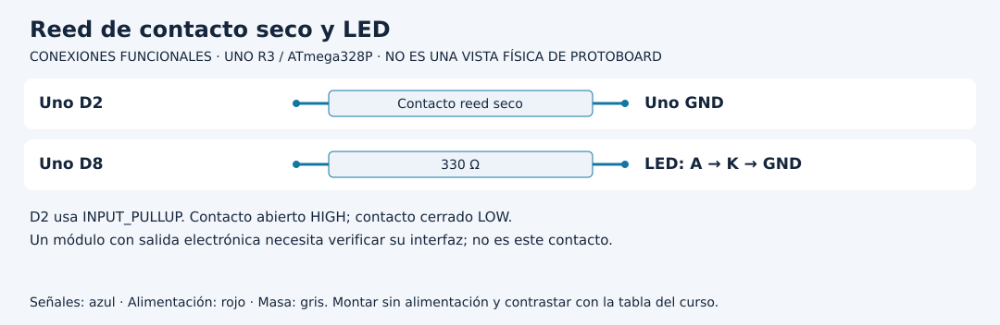

# Del contacto magnético a una interpretación de estado

[Unidad](README.md) · [Laboratorio](LABORATORIO.md) · [Soluciones](SOLUCIONES.md)

**Programas de referencia:** [contacto_reed](ejemplos/contacto_reed/contacto_reed.ino). Abre el archivo completo mientras sigues el desarrollo.

## Esquema de conexiones

Estos esquemas muestran terminales y recorridos eléctricos, no posiciones de una protoboard ni orientaciones universales de componentes. Contrasta las etiquetas con tu pieza y con [la tabla de conexiones](../docs/CONEXIONES.md).

## 1. Qué mide un reed

Un reed de contacto seco cambia continuidad ante determinadas condiciones magnéticas. El programa lee continuidad, no la distancia exacta a un imán. Una etiqueta como PUERTA ABIERTA exige además decidir cómo se instaló y qué tipo de contacto se utiliza.

Conecta el contacto entre D2 y GND, con `INPUT_PULLUP`. Puedes usar un pulsador para practicar la lógica, pero registra esa sustitución. No equivale a comprobar funcionamiento magnético ni alcance del sensor.

## 2. La misma estabilización, otro uso

Se reutiliza `Curso::Boton` para aceptar cambios después de 30 ms. Sin embargo, el sketch no usa su retorno como orden para alternar una salida. Consulta `entrada.estable` para conocer el nivel aceptado. El retorno informa una pulsación; el atributo estable permite conocer ambos estados.

| Contacto | Nivel aceptado | Variable abierto | LED |
|---|---|---|---|
| Separado | HIGH | true | ON |
| Unido | LOW | false | OFF |

`digitalWrite(LED, abierto)` se ejecuta en cada vuelta. La impresión ocurre solo si cambia respecto a `estadoAnterior`, para evitar llenar el monitor con miles de mensajes iguales.

## 3. Entiende la primera observación

El objeto comienza con nivel estable HIGH y `estadoAnterior` también es true. Un contacto inicialmente abierto no genera una transición que imprimir. El LED puede encenderse sin un mensaje inicial de CONTACTO ABIERTO. Al cerrar y esperar estabilización aparece el mensaje de cerrado. Si comienza cerrado, durante la espera inicial todavía conserva HIGH.

No interpretes la ausencia de un mensaje de transición como falta de ejecución. Si quieres un reporte de arranque, debes diseñarlo expresamente.

## 4. Sigue el recorrido físico

Primero prueba abrir y cerrar manualmente un contacto. Después usa el reed, registra la orientación y repite acercamiento y separación. Conserva el mismo cableado y comprueba que la interpretación elegida coincide con esa instalación. No uses un módulo de salida activa como si fuera contacto seco sin revisar su interfaz.

## 5. Reconoce una limitación importante

Un cable cortado puede verse igual que un contacto abierto. El software no dispone de información suficiente para distinguirlos en este circuito. Una supervisión eléctrica adicional, con otra codificación de estados, sería un diseño nuevo. Cambiar el texto del mensaje no crea esa capacidad.

[Realizar el laboratorio](LABORATORIO.md) · [Contrastar las respuestas](SOLUCIONES.md) · [Volver a la unidad](README.md)
