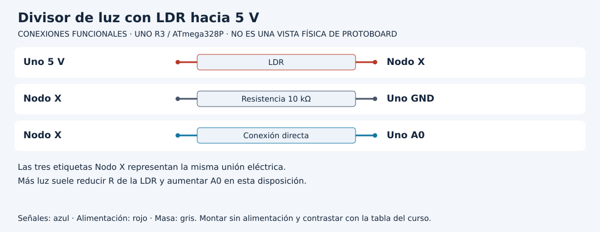

# Interpretar un divisor de luz y un filtro

[Unidad](README.md) · [Laboratorio](LABORATORIO.md) · [Soluciones](SOLUCIONES.md)

**Programas de referencia:** [luz_filtrada](ejemplos/luz_filtrada/luz_filtrada.ino). Abre el archivo completo mientras sigues el desarrollo.

## Esquema de conexiones

Estos esquemas muestran terminales y recorridos eléctricos, no posiciones de una protoboard ni orientaciones universales de componentes. Contrasta las etiquetas con tu pieza y con [la tabla de conexiones](../docs/CONEXIONES.md).

## 1. La posición de la LDR define el sentido

El circuito conecta 5 V, LDR, nodo A0, resistencia de 10 kΩ y GND. La tensión del nodo se aproxima a `5 × R_fija / (R_LDR + R_fija)`. Al aumentar la luz suele disminuir la resistencia de la LDR; en esta disposición sube la tensión de A0.

| Resistencia LDR del modelo | Tensión del nodo con 5 V |
|---:|---:|
| 40 kΩ | 1 V |
| 10 kΩ | 2.5 V |
| 2.5 kΩ | 4 V |

Son valores de un modelo de divisor, no una tabla universal luz/resistencia. Una LDR real necesita caracterización.

## 2. El ADC todavía no devuelve lux

`raw` es una cuenta del convertidor. La iluminación, resistencia y tensión son magnitudes relacionadas, pero diferentes. Para expresar lux hacen falta respuesta del componente y una referencia apropiada. Etiquetar el número con otra unidad no realiza una calibración.

## 3. Sigue el filtro muestra por muestra

El programa toma una muestra cada 100 ms. La primera inicia `filtrado` directamente con `raw`, porque comenzar desde cero crearía un arranque artificial. Después aplica `filtrado += 0.2f * (raw - filtrado)`: corrige el 20 % de la diferencia pendiente.

Si la primera muestra es 500 y luego raw permanece en 700:

| Muestra | raw | filtrado nuevo |
|---:|---:|---:|
| Inicial | 500 | 500 |
| 2 | 700 | 540 |
| 3 | 700 | 572 |
| 4 | 700 | 597.6 |

El filtro se acerca progresivamente. No elimina el error sistemático del sensor; cambia cómo responde a variaciones temporales.

## 4. Compara dos decisiones de suavizado

En una copia usa 0.1 en lugar de 0.2. La primera corrección desde 500 hacia 700 sería de 20 cuentas, no 40. El resultado será más suave y más lento. Con 1.0 sigue directamente cada lectura. Describe el compromiso antes de escoger un coeficiente por apariencia.

## 5. Diseña una observación repetible

Mantén el sensor quieto, registra un tramo sin cambios y después cúbrelo sin modificar cables. Compara raw y filtrado en el mismo instante. No compares un dato filtrado de después con un raw anterior sin aclararlo. Si inviertes físicamente LDR y resistencia, debes rehacer la interpretación del sentido; una condición de oscuridad podría quedar invertida.

[Realizar el laboratorio](LABORATORIO.md) · [Contrastar las respuestas](SOLUCIONES.md) · [Volver a la unidad](README.md)
