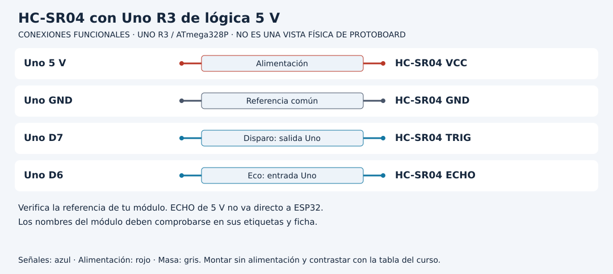

# Laboratorio 12: HC-SR04: distancia con timeout

**[Desarrollo paso a paso: Del tiempo de eco a una distancia válida](DESARROLLO.md)**. Sigue el recorrido del código, las tablas y los experimentos antes de resolver la práctica.

[Unidad](README.md) · [Entorno](../docs/ENTORNO.md) · [Conexiones de referencia](../docs/CONEXIONES.md)

## Esquema de conexiones

Estos esquemas muestran terminales y recorridos eléctricos, no posiciones de una protoboard ni orientaciones universales de componentes. Contrasta las etiquetas con tu pieza y con [la tabla de conexiones](../docs/CONEXIONES.md).

## Objetivo y materiales

HC-SR04: distancia con timeout. Utiliza la referencia **Uno R3 con ATmega328P**; Uno R4 y placas de 3.3 V no son sustitutos eléctricos automáticos.

HC-SR04 compatible 5 V: VCC 5 V, GND común, TRIG → D7, ECHO → D6. Referencia Uno R3; ECHO 5 V no es compatible directamente con ESP32.

Los números D/A corresponden a etiquetas de la tarjeta, no a patillas del chip. Trabaja con un montaje por vez, desenergiza antes de modificar cables y comprueba las conexiones en [CONEXIONES.md](../docs/CONEXIONES.md). Si tu componente tiene otra referencia, consulta su ficha y registra la adaptación.

## Preparación, paso a paso

1. Completa el entorno y diagnóstico USB de Unidad 00.
2. Monta sin alimentación los componentes indicados y revisa polaridad, referencia común y resistencia de cada LED.
3. Abre uno de los programas completos: [distancia_timeout](ejemplos/distancia_timeout/distancia_timeout.ino). El archivo `.ino` y su carpeta tienen el mismo nombre; los `.h` adyacentes forman parte de ese programa.
4. Selecciona Uno y puerto, compila y lee los mensajes del IDE. Una compilación fallida no se corrige cambiando un cable.
5. Carga por USB y abre monitor a **115200 baud**. En prácticas de potencia conserva la fuente dedicada según el diseño de conexiones.
6. Mide regla a 10,30 y 100cm frente a superficie plana. Prueba sin objeto dentro de alcance; conserva INVALIDO.
7. Registra resultado antes de modificar una sola condición. Vuelve al programa original tras experimentar.

## Resultado esperado

Distancia aproximada; timeout o fuera de 2..400cm se rechaza. No muestra 0cm como medición fallida.

Este resultado es un criterio para comprobar, no una afirmación de prueba física ya realizada. Conserva fecha, placa, componentes, entrada, esperado y observado en [EVIDENCIAS.md](../docs/EVIDENCIAS.md). Identifica cuándo se trata de cálculo, simulación o hardware real.

## Lectura del programa

TRIG10 µs inicia esta referencia; pulseIn tiene límite 25 ms. Velocidad 0.0343cm/µs representa aproximadamente 343m/s y se divide por 2 por ida/vuelta. El intervalo 100 ms limita mezcla de ecos.

Lee primero `setup` para conocer el estado inicial, después `loop` y finalmente las funciones auxiliares. Si el ejemplo incluye `Logica.h` o `Trama.h`, abre ese archivo: contiene la regla real utilizada, no un paquete oculto. Las pruebas de escritorio utilizan las mismas funciones para verificar límites; todavía necesitas contrastar el montaje eléctrico.

## Ejercicios

1. Calcula distancia para 1000 µs.
2. ¿La ausencia de objeto debe dar 0?
3. ¿pulseIn es no bloqueante?

Intenta predecir antes de ejecutar y consulta [SOLUCIONES.md](SOLUCIONES.md) después. Explica la causa de una diferencia entre previsto y observado; no cambies el objetivo para convertir un fallo en éxito.

## Diagnóstico de la práctica

- Sin mensajes: comprueba cable de datos, puerto, velocidad y RESET antes de añadir periféricos.
- Programa cargado sin efecto: compara pin, polaridad y referencia de masa; desenergiza antes de corregir.
- Lecturas inesperadas: distingue ruido, entrada flotante, rango, sensor e interpretación; no conviertas un error en valor válido silenciosamente.
- Reinicios al añadir una carga: revisa presupuesto de fuente y etapa de potencia. El GPIO ordena, no alimenta motores.

## Alcance

La velocidad depende del ambiente. No garantiza precisión de cada módulo ni superficies inclinadas.

Vuelve a [la unidad](README.md) para avanzar con su navegación. [Volver a Aprende con Leli](https://lelyliliana.github.io/aprende-con-leli/cursos/arduino/).
