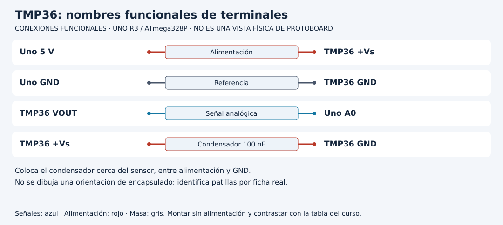

# Convertir tensión a temperatura sin perder el sensor

[Unidad](README.md) · [Laboratorio](LABORATORIO.md) · [Soluciones](SOLUCIONES.md)

**Programas de referencia:** [temperatura_tmp36](ejemplos/temperatura_tmp36/temperatura_tmp36.ino). Abre el archivo completo mientras sigues el desarrollo.

## Esquema de conexiones

Estos esquemas muestran terminales y recorridos eléctricos, no posiciones de una protoboard ni orientaciones universales de componentes. Contrasta las etiquetas con tu pieza y con [la tabla de conexiones](../docs/CONEXIONES.md).

## 1. La fórmula pertenece a un componente

Este laboratorio utiliza TMP36. Su modelo tiene una salida de 0.5 V a 0 °C y una pendiente de 0.01 V por grado Celsius. Despejando: `T = (V - 0.5) × 100`. Un LM35 no comparte el mismo offset; que ambos tengan tres patas no los hace intercambiables.

Identifica alimentación, masa y VOUT en la ficha del encapsulado real. El esquema muestra nombres funcionales, no la vista frontal universal de cualquier pieza. El condensador de 100 nF se coloca cerca del sensor entre alimentación y GND.

## 2. Dos conversiones, dos supuestos

`analogRead(A0)` produce una cuenta. `temperaturaTmp36` estima la tensión del centro de ese intervalo con `(raw + 0.5) × referencia / 1024`. Después aplica la ecuación del sensor. La referencia de 5.0 V es un supuesto ajustable con medición apropiada, no un dato que la función descubre sola.

| Entrada al modelo | Tensión aproximada | Temperatura aproximada |
|---|---:|---:|
| Tensión ideal para 0 °C | 0.50 V | 0 °C |
| Tensión ideal para 25 °C | 0.75 V | 25 °C |
| raw 153 con referencia 5 V | 0.7495 V | 24.95 °C |
| raw 154 con referencia 5 V | 0.7544 V | 25.44 °C |

No esperes que todos los enteros de temperatura correspondan exactamente a una cuenta ADC.

## 3. Una función comunica valor y validez

La firma recibe `float &t`. La referencia permite que la función escriba la temperatura en una variable del llamador. Su retorno booleano informa si el resultado está dentro del contrato. El sketch utiliza t solo si el retorno es verdadero.

La función rechaza cuentas fuera de 0..1023, referencia no finita o no positiva y temperaturas fuera de -40..125 °C. Una cuenta dentro del rango puede provenir de un sensor desconectado: plausibilidad numérica y salud del sensor son comprobaciones diferentes.

## 4. Comprueba antes de ajustar

Registra diez lecturas en un ambiente estable y, si tienes un termómetro de referencia, compara bajo condiciones similares. Corregir la referencia de tensión no es lo mismo que compensar toda diferencia de temperatura. Primero revisa montaje, modelo, tensión y condiciones de comparación.

Imprimir un decimal no demuestra precisión de una décima. Con referencia de 5 V, un paso ADC ya corresponde aproximadamente a 0.49 °C según este modelo, además de otras fuentes de error.

## 5. Extensión razonada

Antes de añadir un mensaje de humedad identifica otro sensor, sus unidades y su protocolo. Este TMP36 no produce humedad. Mantener datos ausentes como ausentes es parte de construir un sistema que pueda interpretarse correctamente.

[Realizar el laboratorio](LABORATORIO.md) · [Contrastar las respuestas](SOLUCIONES.md) · [Volver a la unidad](README.md)
