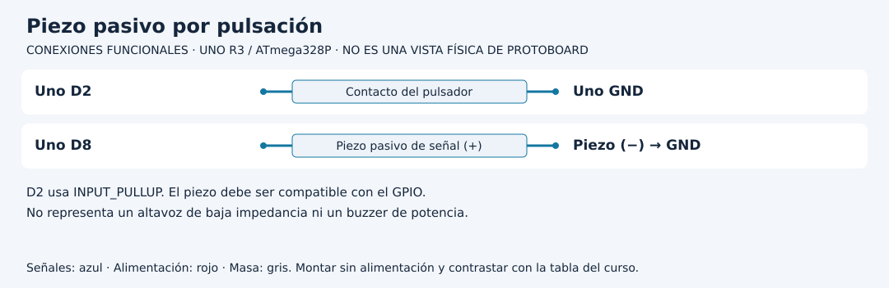

# Programar sonido por eventos

[Unidad](README.md) · [Laboratorio](LABORATORIO.md) · [Soluciones](SOLUCIONES.md)

**Programas de referencia:** [buzzer_eventos](ejemplos/buzzer_eventos/buzzer_eventos.ino). Abre el archivo completo mientras sigues el desarrollo.

## Esquema de conexiones

Estos esquemas muestran terminales y recorridos eléctricos, no posiciones de una protoboard ni orientaciones universales de componentes. Contrasta las etiquetas con tu pieza y con [la tabla de conexiones](../docs/CONEXIONES.md).

## 1. Una señal eléctrica necesita un transductor apropiado

La referencia usa un piezo pasivo de señal compatible con el GPIO. Un altavoz de baja impedancia o un buzzer de potencia necesita otro diseño de control. La etiqueta buzzer no permite deducir consumo ni interfaz.

Un piezo pasivo transforma la señal alternante en vibración. Un buzzer activo incorpora un oscilador y su comportamiento no se describe igual enviando una frecuencia externa. Identifica el componente antes de interpretar el resultado.

## 2. Reutilizar el evento del botón

El botón entre D2 y GND usa `INPUT_PULLUP`. `boton.actualizar` confirma una nueva pulsación estable. Solo entonces se ejecuta `tone(BUZZER, 1000, 150)`: salida en D8, frecuencia de 1000 Hz y duración de 150 ms.

| Momento | Decisión |
|---|---|
| Primer contacto LOW | Empieza estabilización |
| LOW estable durante 30 ms | Solicita un tono |
| Mantener pulsado | No solicita tonos nuevos |
| Transcurren unos 150 ms de tono | Finaliza la emisión programada |
| Liberar estable y volver a pulsar | Puede solicitar otro tono |

El tiempo de estabilización y la duración del sonido pertenecen a mecanismos distintos.

## 3. Frecuencia y duración no son volumen

Cambiar 1000 por 1500 modifica la frecuencia solicitada. La duración sigue siendo 150 ms. Cambiar 150 por 300 alarga el sonido y no cambia por sí mismo su frecuencia. El nivel acústico depende también del componente y montaje; no lo controles suponiendo que cualquier número mayor significa más volumen.

`tone` programa la generación y el recorrido de loop continúa. No equivale a detener el programa 150 ms con delay. `noTone` permite cancelar una emisión en ese pin; no espera que finalice una pausa del usuario.

## 4. Revisa recursos al integrar

En Uno AVR, la implementación de tono utiliza un temporizador que puede afectar PWM en D3 y D11. El pin donde conectas el piezo no es toda la historia: una biblioteca puede consumir recursos que otras funciones necesitan. Este laboratorio no combina esas salidas.

## 5. Prueba mínima y extensión

Primero confirma un tono por pulsación. Después conserva pulsado y cuenta mensajes. En una copia añade un comando Serial para cancelar el tono con `noTone(BUZZER)`; debes inicializar y atender ese comando sin bloquear la lectura del botón. Define si una nueva pulsación puede reiniciar una emisión todavía activa. Esa decisión forma parte del comportamiento, no de la conexión eléctrica.

[Realizar el laboratorio](LABORATORIO.md) · [Contrastar las respuestas](SOLUCIONES.md) · [Volver a la unidad](README.md)
