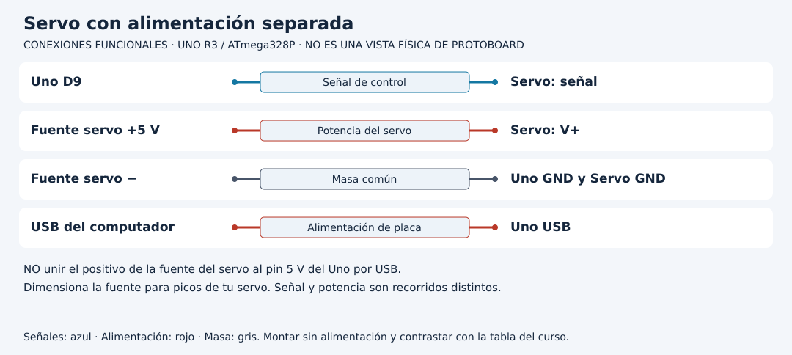

# Controlar un servo sin confundir orden y posición

[Unidad](README.md) · [Laboratorio](LABORATORIO.md) · [Soluciones](SOLUCIONES.md)

**Programas de referencia:** [servo_limitado](ejemplos/servo_limitado/servo_limitado.ino). Abre el archivo completo mientras sigues el desarrollo.

## Esquema de conexiones

Estos esquemas muestran terminales y recorridos eléctricos, no posiciones de una protoboard ni orientaciones universales de componentes. Contrasta las etiquetas con tu pieza y con [la tabla de conexiones](../docs/CONEXIONES.md).

## 1. Tres conexiones con responsabilidades diferentes

El servo de referencia recibe señal por D9, energía desde una fuente regulada de 5 V adecuada a sus picos y masa común con Uno. El Uno permanece por USB. No unas el positivo de la fuente del servo al riel de 5 V del Uno alimentado por USB. La señal indica una orden; no proporciona la energía del motor.

El nombre comercial SG90 no garantiza consumo, pinout o recorrido de cualquier copia. Identifica la unidad real, empieza sin carga mecánica y utiliza posiciones moderadas. El esquema separa expresamente los dos positivos y une solo las masas requeridas por esta referencia.

## 2. Qué añade Servo.h

`Servo servo` crea un objeto. `servo.attach(9)` lo asocia a D9 y habilita la generación de pulsos de la biblioteca. `servo.write(60)` solicita una posición según el mapeo configurado. No devuelve una medición del eje. Un servomotor convencional realiza control interno, pero este programa no recibe realimentación de su posición física.

D9 no se elige aquí por `analogWrite`. Servo utiliza su mecanismo temporal; la señal de control del servo no es equivalente al PWM de brillo de LED.

## 3. Sigue el arranque y la alternancia

| Tiempo aproximado | posAlta | Orden enviada |
|---:|---|---:|
| Arranque | false | 60 |
| 2000 ms | true | 120 |
| 4000 ms | false | 60 |
| 6000 ms | true | 120 |

`posAlta = !posAlta` conserva la fase. `write` se llama al cambiar, pero la biblioteca sigue generando señal entre cambios. Un periodo de órdenes de dos segundos no significa que el motor tarde exactamente dos segundos en llegar ni que el eje esté donde se solicitó.

## 4. Construye una comparación útil

Observa primero 60 y 120 sin carga. Detén si fuerza un tope, vibra o se calienta. En una copia usa 80 y 100 para reducir el recorrido. Comprueba que ambas órdenes se distinguen antes de añadir una pieza mecánica. No cambies directamente a 0 y 180 suponiendo que todo servo acepta esos extremos.

Si el Uno se reinicia al moverse el eje, investiga fuente, picos de corriente y conexiones de masa antes de cambiar el intervalo. Que compile no demuestra que la alimentación soporte el montaje.

## 5. Recurso compartido

En el Uno AVR la biblioteca Servo utiliza timer 1 y afecta `analogWrite` en D9 y D10 mientras está en uso. Mover la señal del servo a otro pin no devuelve automáticamente ese temporizador a PWM. Antes de combinar servo y control de LED/motor, revisa el mapa de pines y recursos.

[Realizar el laboratorio](LABORATORIO.md) · [Contrastar las respuestas](SOLUCIONES.md) · [Volver a la unidad](README.md)
