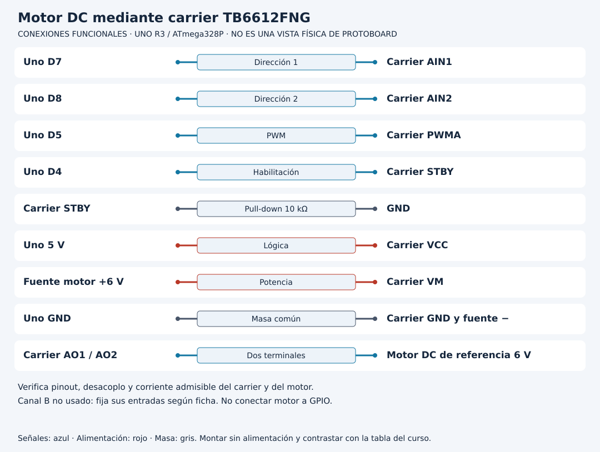

# Laboratorio 16: Motor DC con TB6612FNG

**[Desarrollo paso a paso: Separar control y potencia en un motor DC](DESARROLLO.md)**. Sigue el recorrido del código, las tablas y los experimentos antes de resolver la práctica.

[Unidad](README.md) · [Entorno](../docs/ENTORNO.md) · [Conexiones de referencia](../docs/CONEXIONES.md)

## Esquema de conexiones

Estos esquemas muestran terminales y recorridos eléctricos, no posiciones de una protoboard ni orientaciones universales de componentes. Contrasta las etiquetas con tu pieza y con [la tabla de conexiones](../docs/CONEXIONES.md).

## Objetivo y materiales

Motor DC con TB6612FNG. Utiliza la referencia **Uno R3 con ATmega328P**; Uno R4 y placas de 3.3 V no son sustitutos eléctricos automáticos.

Carrier TB6612FNG: VCC 5 V lógico, VM 6 V desde fuente limitada y dimensionada para motor 6 V, GND común. AIN1 → D7, AIN2 → D8, PWMA D5, STBY D4 con pull-down 10 kΩ a GND; motor en AO1/AO2. Verifica esquema del carrier y corriente de bloqueo.

Los números D/A corresponden a etiquetas de la tarjeta, no a patillas del chip. Trabaja con un montaje por vez, desenergiza antes de modificar cables y comprueba las conexiones en [CONEXIONES.md](../docs/CONEXIONES.md). Si tu componente tiene otra referencia, consulta su ficha y registra la adaptación.

## Preparación, paso a paso

1. Completa el entorno y diagnóstico USB de Unidad 00.
2. Monta sin alimentación los componentes indicados y revisa polaridad, referencia común y resistencia de cada LED.
3. Abre uno de los programas completos: [motor_tb6612](ejemplos/motor_tb6612/motor_tb6612.ino). El archivo `.ino` y su carpeta tienen el mismo nombre; los `.h` adyacentes forman parte de ese programa.
4. Selecciona Uno y puerto, compila y lee los mensajes del IDE. Una compilación fallida no se corrige cambiando un cable.
5. Carga por USB y abre monitor a **115200 baud**. En prácticas de potencia conserva la fuente dedicada según el diseño de conexiones.
6. Prueba sin carga y fija motor. Envía f por máximo 5 s. Envía 0, espera que rotor esté detenido y luego r. Nunca cambies sentido con motor en marcha.
7. Registra resultado antes de modificar una sola condición. Vuelve al programa original tras experimentar.

## Resultado esperado

Arranque deshabilitado; f/r activan PWM 128; timeout 5 s apaga driver. El programa rechaza nueva dirección mientras activo.

Este resultado es un criterio para comprobar, no una afirmación de prueba física ya realizada. Conserva fecha, placa, componentes, entrada, esperado y observado en [EVIDENCIAS.md](../docs/EVIDENCIAS.md). Identifica cuándo se trata de cálculo, simulación o hardware real.

## Lectura del programa

STBY deshabilita puente; IN1/IN2 definen sentido y PWMA modula. Parar salida no garantiza detención física inmediata. VM alimenta motor; VCC lógica. El programa no conoce corriente ni temperatura real.

Lee primero `setup` para conocer el estado inicial, después `loop` y finalmente las funciones auxiliares. Si el ejemplo incluye `Logica.h` o `Trama.h`, abre ese archivo: contiene la regla real utilizada, no un paquete oculto. Las pruebas de escritorio utilizan las mismas funciones para verificar límites; todavía necesitas contrastar el montaje eléctrico.

## Ejercicios

1. ¿PWM 128 significa mitad de velocidad exacta?
2. ¿Por qué STBY con pull-down?
3. ¿Qué determina fuente/driver?

Intenta predecir antes de ejecutar y consulta [SOLUCIONES.md](SOLUCIONES.md) después. Explica la causa de una diferencia entre previsto y observado; no cambies el objetivo para convertir un fallo en éxito.

## Diagnóstico de la práctica

- Sin mensajes: comprueba cable de datos, puerto, velocidad y RESET antes de añadir periféricos.
- Programa cargado sin efecto: compara pin, polaridad y referencia de masa; desenergiza antes de corregir.
- Lecturas inesperadas: distingue ruido, entrada flotante, rango, sensor e interpretación; no conviertas un error en valor válido silenciosamente.
- Reinicios al añadir una carga: revisa presupuesto de fuente y etapa de potencia. El GPIO ordena, no alimenta motores.

## Alcance

No conectar red doméstica. El ejemplo no implementa realimentación ni freno certificado.

Vuelve a [la unidad](README.md) para avanzar con su navegación. [Volver a Aprende con Leli](https://lelyliliana.github.io/aprende-con-leli/cursos/arduino/).
