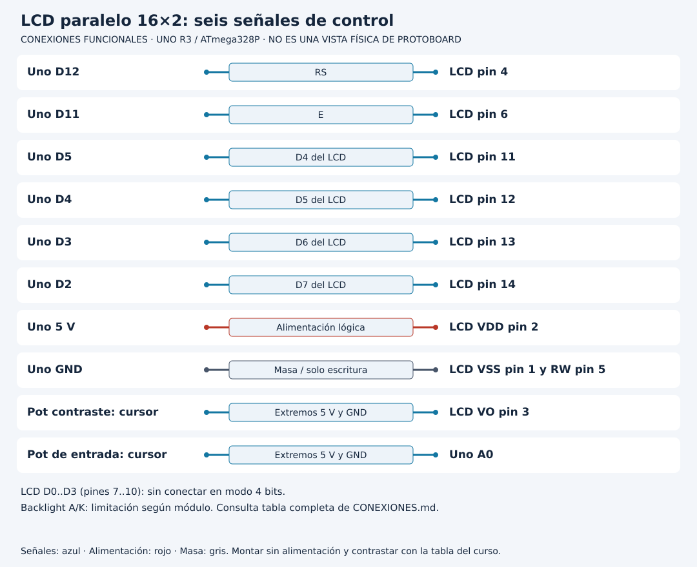

# Mostrar un dato sin perder la conexión de la pantalla

[Unidad](README.md) · [Laboratorio](LABORATORIO.md) · [Soluciones](SOLUCIONES.md)

**Programas de referencia:** [lcd_16x2](ejemplos/lcd_16x2/lcd_16x2.ino). Abre el archivo completo mientras sigues el desarrollo.

## Esquema de conexiones

Estos esquemas muestran terminales y recorridos eléctricos, no posiciones de una protoboard ni orientaciones universales de componentes. Contrasta las etiquetas con tu pieza y con [la tabla de conexiones](../docs/CONEXIONES.md).

## 1. Identifica la interfaz antes de la biblioteca

La referencia es un LCD 16×2 compatible con HD44780 y conexión paralela de 16 pines. Un módulo con backpack de cuatro pines e I2C necesita otro montaje y otra interfaz. Que ambos muestren dos filas no permite cargar el mismo programa sin cambios.

Hay dos potenciómetros distintos: uno ajusta VO para contraste del LCD; otro lleva una tensión a A0 para el dato. Compartir sus cursores mezclaría funciones y alteraría el experimento.

## 2. Interpreta los números del constructor

`LiquidCrystal lcd(12, 11, 5, 4, 3, 2)` enumera los pines del Uno conectados a RS, E, D4, D5, D6 y D7 del LCD, en ese orden. D4 del LCD no significa D4 de Arduino.

| Señal LCD | Pin Uno |
|---|---|
| RS | D12 |
| E | D11 |
| D4 | D5 |
| D5 | D4 |
| D6 | D3 |
| D7 | D2 |

RW va a GND para usar escritura. Las líneas D0..D3 del LCD no se emplean en modo de cuatro bits. La biblioteca divide internamente los bytes en transferencias de cuatro bits.

## 3. Sigue el cursor

En `setup`, `lcd.begin(16, 2)` establece dimensiones y `lcd.print` escribe el título. Luego, cada 500 ms, `setCursor(0, 1)` sitúa el cursor en primera columna de segunda fila. Las posiciones comienzan en cero.

Se imprime ADC=, el número y cinco espacios. Si antes aparecía 1023 y ahora 8, el número nuevo por sí solo sobrescribiría únicamente el primer carácter del anterior. Los espacios limpian la parte sobrante. No es necesario borrar toda la pantalla para actualizar una región.

## 4. Diagnostica por capas

Con luz y sin texto, revisa primero contraste, alimentación, RW y correspondencia de señales. La retroiluminación es un circuito diferente del controlador de caracteres. Requiere la limitación de corriente indicada por el módulo; no asumas que siempre hay una resistencia incorporada.

Si el monitor muestra ADC correcto pero el LCD no cambia, el problema se localiza después de la adquisición. Si ambos valores son erráticos, revisa el potenciómetro de entrada y A0. Esa comparación aporta más que volver a cargar repetidamente el mismo programa.

## 5. Amplía con un formato limitado

En una copia cambia la etiqueta y representa el porcentaje de la Unidad 05. Define primero el ancho máximo del texto. En una pantalla de 16 columnas, una cadena larga no crea espacio adicional. Evita `clear` en cada vuelta: puede introducir parpadeo y borra zonas que no necesitaban actualizarse.

[Realizar el laboratorio](LABORATORIO.md) · [Contrastar las respuestas](SOLUCIONES.md) · [Volver a la unidad](README.md)
