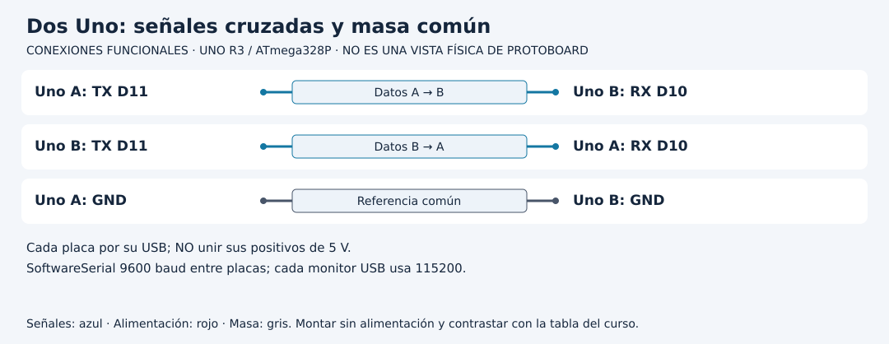

# Recibir una trama completa en dos placas

[Unidad](README.md) · [Laboratorio](LABORATORIO.md) · [Soluciones](SOLUCIONES.md)

**Programas de referencia:** [serial_emisor](ejemplos/serial_emisor/serial_emisor.ino) · [serial_receptor](ejemplos/serial_receptor/serial_receptor.ino). Abre el archivo completo mientras sigues el desarrollo.

## Esquema de conexiones

Estos esquemas muestran terminales y recorridos eléctricos, no posiciones de una protoboard ni orientaciones universales de componentes. Contrasta las etiquetas con tu pieza y con [la tabla de conexiones](../docs/CONEXIONES.md).

## 1. Distingue dos enlaces

Cada Uno usa Serial USB a 115200 para hablar con el computador. Entre placas usa SoftwareSerial a 9600, con RX en D10 y TX en D11. Debes cruzar TX de A con RX de B, y TX de B con RX de A. Une GND; conserva la alimentación USB de cada placa sin unir sus positivos de 5 V.

Un puerto RS232 de tensiones positivas y negativas no es equivalente a esta señal TTL. Tampoco conectes otra familia de tensión sin revisar compatibilidad.

## 2. La unidad de información ya no es un carácter

El emisor escribe `VAL `, luego el número ADC y un final de línea. El receptor acumula caracteres hasta LF. Ignora CR, termina el texto con `\0` y llama a `leerTrama`. Ese cero final marca el fin de una cadena C; no se imprime como el carácter '0'.

| Texto lógico recibido antes de LF | Decisión |
|---|---|
| VAL 0 | Acepta |
| VAL 1023 | Acepta |
| VAL 1024 | Rechaza rango |
| VAL -1 | Rechaza signo |
| VAL 12x | Rechaza carácter |
| ACK 12 | Rechaza prefijo |

El espacio después de VAL forma parte del contrato. El parser acepta de uno a cuatro dígitos y un valor 0..1023; por eso también puede aceptar ceros iniciales dentro de ese límite.

## 3. Sigue el buffer

`buffer[20]` reserva veinte posiciones. Solo usa diecinueve para contenido y conserva una para terminar la cadena. `usados` indica cuántas posiciones están ocupadas. Si llega demasiado texto, `descartar` evita seguir escribiendo y conserva el rechazo hasta el próximo LF.

Al recibir LF, la referencia acepta o rechaza la trama y reinicia `usados` y `descartar`. Así una trama larga no contamina automáticamente la siguiente. No basta truncar el texto y aceptar lo que alcanzó a caber: podría cambiar el significado de un mensaje inválido.

## 4. Qué significa ACK

Para una trama aceptada el receptor imprime el valor y devuelve `ACK valor`. El emisor reenvía al monitor los caracteres recibidos. Ese ACK indica aceptación por este receptor. No acredita almacenamiento durable, identidad del emisor ni una medición física correcta.

## 5. Prueba recuperación además de éxito

Primero ejecuta emisor y receptor sin cambios. Para probar textos inválidos modifica en una copia la transmisión del emisor; escribir en su monitor USB no se reenvía automáticamente al enlace, porque ese comportamiento no está implementado. Envía una trama válida, una inválida y otra válida. Comprueba aceptación, rechazo y recuperación. Define luego qué harías si nunca llega LF: la referencia tiene memoria limitada, pero no implementa timeout de trama incompleta.

[Realizar el laboratorio](LABORATORIO.md) · [Contrastar las respuestas](SOLUCIONES.md) · [Volver a la unidad](README.md)
