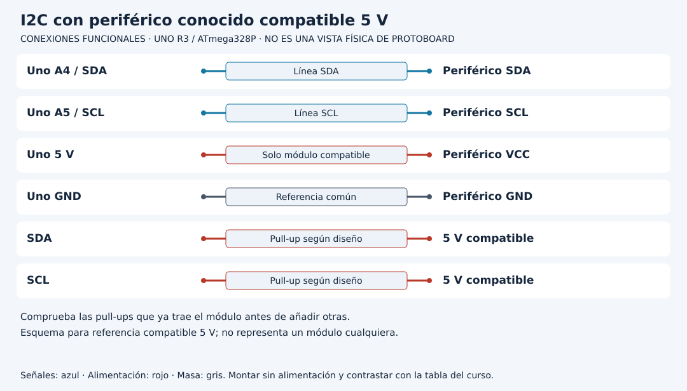
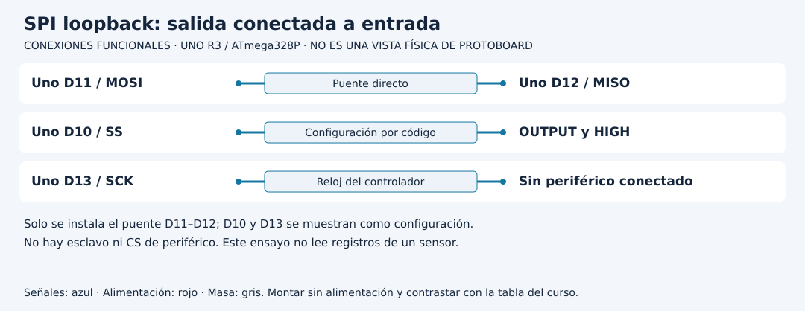

# Comprender qué demuestran I2C y SPI

[Unidad](README.md) · [Laboratorio](LABORATORIO.md) · [Soluciones](SOLUCIONES.md)

**Programas de referencia:** [i2c_escaner](ejemplos/i2c_escaner/i2c_escaner.ino) · [spi_loopback](ejemplos/spi_loopback/spi_loopback.ino). Abre el archivo completo mientras sigues el desarrollo.

## Esquema de conexiones

Estos esquemas muestran terminales y recorridos eléctricos, no posiciones de una protoboard ni orientaciones universales de componentes. Contrasta las etiquetas con tu pieza y con [la tabla de conexiones](../docs/CONEXIONES.md).

## 1. Dos ensayos separados

La primera práctica usa I2C con un periférico conocido y niveles compatibles con 5 V: SDA A4 y SCL A5. La segunda usa SPI sin periférico, uniendo MOSI D11 con MISO D12. Desconecta alimentación para pasar de un ensayo al otro. No combines conexiones solo porque ambos se llamen buses.

## 2. Qué hace el escáner I2C

`Wire.begin` inicia el controlador. Cada tres segundos recorre direcciones 1..126. Para cada una, `beginTransmission` prepara la dirección y `endTransmission` intenta completar la operación. Cuando devuelve cero, se informa ACK. La representación HEX cambia cómo se imprime el número, no la dirección usada.

| Observación | Conclusión permitida |
|---|---|
| ACK en una dirección | Un dispositivo respondió en esa dirección |
| Ningún ACK | No se obtuvo respuesta en este ensayo |
| ACK correcto | Todavía falta comprobar identidad y datos |

Dos componentes pueden compartir una dirección predeterminada. El ACK no permite distinguir automáticamente cuál está conectado. El timeout de Wire limita ciertas esperas, pero no corrige niveles o cableado.

## 3. Pull-ups y tensión lógica

I2C requiere pull-ups. El esquema las representa hacia una tensión compatible con este montaje. Algunos módulos ya las traen; añadir más en paralelo reduce la resistencia equivalente. No elijas el valor ni la tensión por costumbre: revisa módulo, longitud, capacidad y fichas. La alimentación del módulo no demuestra tolerancia de sus señales.

## 4. Qué comprueba el puente SPI

El programa configura 100000 Hz, orden MSBFIRST y modo 0. Envía `0xA5` y simultáneamente recibe ocho bits. Con el puente D11→D12 y montaje correcto espera leer A5. En binario A5 es 10100101; una transferencia desplaza esos bits.

D10 se mantiene como OUTPUT/HIGH para conservar modo controlador en esta referencia AVR. El ensayo no usa un CS de un esclavo porque no hay esclavo: el dato sale y vuelve por un cable. SCK sigue siendo parte de la operación SPI, aunque el puente directo no necesite conectarlo a otro componente.

## 5. Pasar a un sensor real cambia el contrato

Un periférico SPI necesita selección CS, modo, frecuencia, niveles y secuencia de comandos de su ficha. Devolver A5 en loopback no demuestra que se leyó un registro de sensor. Sin puente, MISO puede quedar flotante: el resultado no está definido ni debe interpretarse como identidad de un dispositivo.

[Realizar el laboratorio](LABORATORIO.md) · [Contrastar las respuestas](SOLUCIONES.md) · [Volver a la unidad](README.md)
