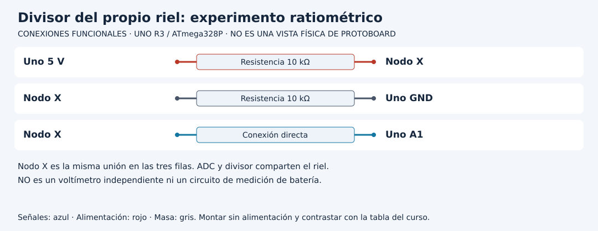

# Diseñar alimentación y reconocer una medición circular

[Unidad](README.md) · [Laboratorio](LABORATORIO.md) · [Soluciones](SOLUCIONES.md)

**Programas de referencia:** [presupuesto_usb](ejemplos/presupuesto_usb/presupuesto_usb.ino). Abre el archivo completo mientras sigues el desarrollo.

## Esquema de conexiones

Estos esquemas muestran terminales y recorridos eléctricos, no posiciones de una protoboard ni orientaciones universales de componentes. Contrasta las etiquetas con tu pieza y con [la tabla de conexiones](../docs/CONEXIONES.md).

## 1. Presupuesto antes de conectar

Una lista de componentes todavía no es un diseño de alimentación. Para cada elemento identifica tensión, corriente relevante, fuente e interfaz. Separa consumo de lógica del de motores, servo o retroiluminación. Usa fichas y condiciones reales: corriente en reposo, arranque y bloqueo no son la misma magnitud.

Una tabla útil puede contener placa por USB, sensor de baja corriente y actuador con fuente dedicada. No inventes el consumo del servo por su nombre. Suma las cargas que pueden coincidir, verifica conectores, disipación y protecciones y registra de dónde proviene cada cifra. La potencia se calcula con `P = V × I`; no sumes amperios de rieles de tensiones diferentes como si describieran una sola fuente.

## 2. El divisor que parece medir 5 V

El montaje usa dos resistencias de 10 kΩ entre el propio riel de 5 V y GND; A1 observa su unión. La tensión de A1 es aproximadamente la mitad del riel. El ADC usa ese mismo riel como referencia predeterminada.

La cuenta depende de la razón `V_entrada / V_referencia`. Si ambos cambian en proporción, la razón sigue aproximadamente en 1/2. El programa, sin embargo, multiplica por una constante nominal de 5.0 V y por dos.

| Riel real hipotético | Nodo A1 | Razón al ADC | Estimación impresa aproximada |
|---:|---:|---:|---:|
| 5.0 V | 2.5 V | 1/2 | 5 V |
| 4.5 V | 2.25 V | 1/2 | 5 V |

El experimento demuestra una limitación del método. No ajustes una fuente para reproducir la segunda fila: es un razonamiento con valores hipotéticos, no una instrucción de variar la alimentación de la placa.

## 3. Lee la ecuación

`(raw + 0.5f) * REFERENCIA / 1024 * FACTOR_DIVISOR` estima el centro de un intervalo ADC y deshace la división por dos. `REFERENCIA` es una constante, no una referencia independiente medida en ese momento. Mostrar cerca de cinco no permite certificar estabilidad del propio riel.

## 4. Qué haría falta para otra medición

Una medición independiente necesita una referencia apropiada y un circuito dimensionado para su entrada, incertidumbre y rango. Medir una batería no consiste en conectar sus terminales directamente al esquema del propio riel. Antes de ampliar hay que diseñar rango, protección y relación de división. Este laboratorio no implementa un voltímetro de batería.

## 5. Integra con una tabla de recursos

Además de corriente, comprueba pines y temporizadores. LCD paralelo ocupa varios pines de prácticas anteriores; Servo y tone consumen temporizadores. Dibuja una propuesta de integración y detecta conflictos antes de montar. Conservar masa común donde el diseño lo requiere no significa unir todos los positivos de fuentes distintas.

[Realizar el laboratorio](LABORATORIO.md) · [Contrastar las respuestas](SOLUCIONES.md) · [Volver a la unidad](README.md)
