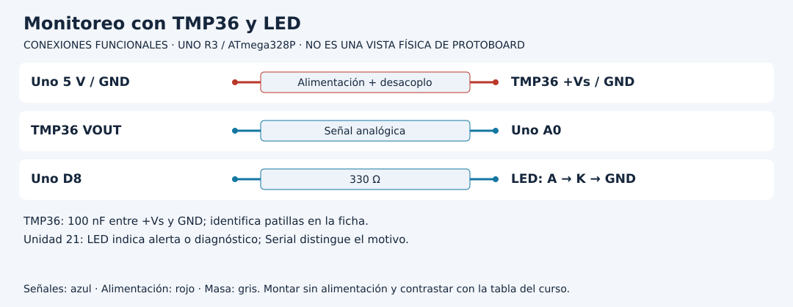

# Construir monitoreo con memoria y diagnóstico

[Unidad](README.md) · [Laboratorio](LABORATORIO.md) · [Soluciones](SOLUCIONES.md)

**Programas de referencia:** [monitoreo_ambiental](ejemplos/monitoreo_ambiental/monitoreo_ambiental.ino). Abre el archivo completo mientras sigues el desarrollo.

## Esquema de conexiones

Estos esquemas muestran terminales y recorridos eléctricos, no posiciones de una protoboard ni orientaciones universales de componentes. Contrasta las etiquetas con tu pieza y con [la tabla de conexiones](../docs/CONEXIONES.md).

## 1. Integra lo que ya comprobaste

El proyecto reúne TMP36 en A0, un LED con resistencia en D8, lectura cada segundo y una regla de histéresis. Primero verifica el sensor con la Unidad 13 y después añade la salida. Un fallo en adquisición no debe investigarse al mismo tiempo que otro en el LED.

El objetivo es indicar alerta por temperatura alta. No mide humedad, no guarda histórico y no envía datos a Internet. Esas extensiones necesitarían componentes y código propios.

## 2. Dos umbrales y un estado anterior

La regla activa al alcanzar 30 °C y libera al llegar a 28 °C o menos. Entre ambos conserva la alerta anterior. No se decide únicamente a partir de la temperatura actual.

| Temperatura válida | Alerta anterior | Alerta siguiente |
|---:|---|---|
| 29 °C | OFF | OFF |
| 30 °C | OFF | ON |
| 29 °C | ON | ON |
| 28 °C | ON | OFF |

En `histeresisAlta`, si ya estaba activa se conserva mientras `valor > bajo`; si estaba apagada necesita `valor >= alto`. Observa la diferencia entre las comparaciones de cada frontera.

## 3. Traza el programa completo

Si aún no pasó un segundo, `return` termina esa vuelta. Cuando vence la espera, se adquiere y convierte una muestra. Solo si la conversión es válida se aplica la histéresis y se imprime temperatura y alerta. El LED refleja el resultado de la regla.

Si la conversión falla, el proyecto reinicia `alerta` a false, enciende el LED e imprime DATO INVALIDO. Ese LED significa **alerta o diagnóstico**, según el monitor. No significa siempre temperatura alta. Si vuelve un dato válido de 29 °C después del fallo, parte de alerta false y queda OFF; la memoria previa de alerta se reinició.

## 4. Ensaya la regla sin calentar peligrosamente

La secuencia 29, 30, 29, 28 puede probarse con los casos de escritorio del curso o en una copia con entradas controladas a la función. Registra que fue una prueba de regla. La prueba física del sensor requiere una comparación de temperatura y condiciones apropiadas; no uses calentamiento intenso para forzar umbrales.

## 5. Una extensión de diagnóstico completa

Si incorporas LCD, representa tres estados: normal, alerta y dato inválido. Un fallo no se escribe como 0 °C ni se muestra una temperatura vieja como si fuera nueva. Debes revisar pines del LCD antes de combinarlo: el montaje paralelo original puede ocupar recursos ya usados. Conserva adquisición, regla y representación separadas para modificar la interfaz sin reescribir la conversión.

[Realizar el laboratorio](LABORATORIO.md) · [Contrastar las respuestas](SOLUCIONES.md) · [Volver a la unidad](README.md)
