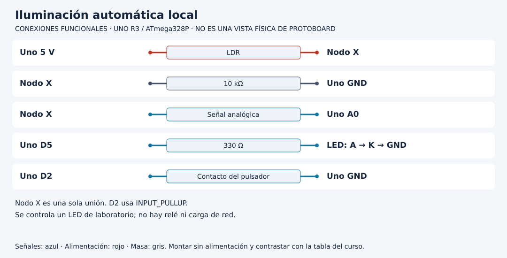

# Automatizar una luz con modo y dos fronteras

[Unidad](README.md) · [Laboratorio](LABORATORIO.md) · [Soluciones](SOLUCIONES.md)

**Programas de referencia:** [luz_automatica](ejemplos/luz_automatica/luz_automatica.ino). Abre el archivo completo mientras sigues el desarrollo.

## Esquema de conexiones

Estos esquemas muestran terminales y recorridos eléctricos, no posiciones de una protoboard ni orientaciones universales de componentes. Contrasta las etiquetas con tu pieza y con [la tabla de conexiones](../docs/CONEXIONES.md).

## 1. Separa condición ambiental y permiso

`oscuro` representa la condición recordada por la histéresis. `habilitado` permite actuar automáticamente. El LED solo recibe PWM 128 si ambas son verdaderas. El botón no mide luz: cambia el permiso de actuación.

El circuito combina LDR hacia 5 V, resistencia de 10 kΩ hacia GND y nodo A0; LED con resistencia en D5 y pulsador D2→GND. Se controla solo un LED de laboratorio. Añadir un relé no es una sustitución de pin: requeriría otra etapa y otro diseño.

## 2. Deriva los umbrales en vez de memorizarlos

Con este divisor, oscuridad suele reducir raw. La función compartida activa por un valor alto, así que el proyecto transforma `valor = 1023 - raw`.

| raw | Valor invertido | Interpretación de frontera |
|---:|---:|---|
| 400 | 623 | Activa oscuro si estaba apagado |
| 500 | 523 | Conserva estado anterior |
| 600 | 423 | Libera oscuro si estaba activo |

La equivalencia permite reutilizar la función sin cambiar el sentido físico del divisor. Si se intercambian LDR y resistencia, también hay que revisar esa interpretación.

## 3. Sigue un recorrido con memoria

Desde `oscuro=false`, raw 700 conserva apagado; raw 350 activa; raw 500 mantiene activo; raw 650 libera. El caso 500 no tiene una única respuesta sin conocer el recorrido anterior. Repite en sentido contrario para comprobarlo.

En cada muestra de 100 ms se actualiza `oscuro`, incluso si el modo está deshabilitado. Deshabilitar no congela el sensor; obliga a la salida a permanecer apagada.

## 4. El botón puede actuar antes de la próxima muestra

El evento estabilizado cambia `habilitado`. Al deshabilitar se escribe PWM cero inmediatamente dentro de esa rama. Al habilitar no se fuerza encendido inmediatamente: la próxima actualización del sensor aplica la combinación de permiso y oscuridad. En condiciones normales la espera restante es de hasta aproximadamente un periodo de muestreo.

Mantener el botón no alterna continuamente el modo. El objeto de estabilización produce un evento, como en la Unidad 04.

## 5. Elige umbrales con datos propios

Registra cuentas en condiciones que para tu aplicación signifiquen suficiente luz y oscuridad. Los valores 400/600 no son umbrales universales de lux. El proyecto no utiliza el filtro de la Unidad 11; emplea lectura directa más histéresis. Ambos mecanismos pueden combinarse, pero eso cambiaría el tiempo de respuesta y requeriría repetir el ensayo.

[Realizar el laboratorio](LABORATORIO.md) · [Contrastar las respuestas](SOLUCIONES.md) · [Volver a la unidad](README.md)
