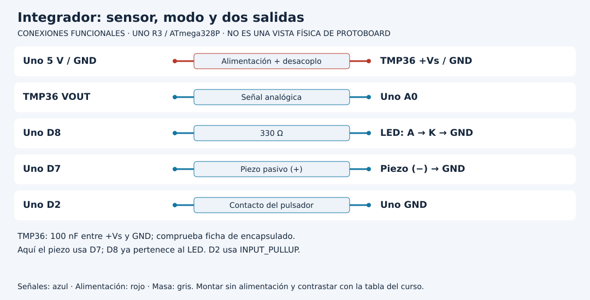

# Transferir el integrador a un proyecto propio

[Unidad](README.md) · [Laboratorio](LABORATORIO.md) · [Soluciones](SOLUCIONES.md)

**Programas de referencia:** [integrador_local](ejemplos/integrador_local/integrador_local.ino). Abre el archivo completo mientras sigues el desarrollo.

## Esquema de conexiones

Estos esquemas muestran terminales y recorridos eléctricos, no posiciones de una protoboard ni orientaciones universales de componentes. Contrasta las etiquetas con tu pieza y con [la tabla de conexiones](../docs/CONEXIONES.md).

## 1. Define primero qué hará el prototipo

La referencia integra temperatura TMP36, alerta con histéresis, LED D8, piezo D7 y botón D2. Tiene tres dimensiones distintas: dato válido, alerta calculada y permiso `habilitado` para representar la alerta. Separarlas evita llamar normal a un dato inválido o confundir silencio con desaparición de la causa.

Comienza con el monitoreo de la Unidad 21. Después prueba el botón y al final añade el piezo. Cada incorporación debe conservar los casos anteriores. La tabla de conexiones del integrador usa D7 para el piezo; no copies D8 de la práctica aislada porque aquí D8 ya es el LED.

## 2. Sigue la decisión de salida

| Dato | Alerta | Habilitado | LED y sonido |
|---|---|---|---|
| Válido | OFF | true | Apagados |
| Válido | ON | true | LED ON y tono breve en cada actualización |
| Válido | ON | false | Apagados; alerta sigue calculándose |
| Inválido | Se reinicia a OFF | Cualquiera | Apagados y mensaje de error |

La política ante dato inválido difiere de la Unidad 21: allí el LED se enciende como diagnóstico; aquí se apagan las salidas y se conserva el mensaje de error. Es una diferencia real de implementación que debes justificar al diseñar tu propia interfaz.

## 3. Un tono por actualización, no uno por transición

Cada segundo, si está habilitado y en alerta, se solicita `tone(BUZZER, 1200, 100)`. El sonido dura 100 ms nominales. Si la alerta permanece, la próxima muestra vuelve a solicitar otro tono. No es un único aviso al entrar al estado.

El botón cambia habilitado. Al silenciar ejecuta `apagar`, que lleva LED a LOW y llama a `noTone`. Al rehabilitar, las salidas se deciden en la próxima muestra. Mientras está silenciado, el sensor y la histéresis siguen trabajando.

## 4. Ensaya un recorrido completo

Diseña casos controlados: normal, activación, permanencia en banda, silencio, rehabilitación y liberación. Para datos inválidos prueba la conversión con valores fuera del contrato en escritorio; no asumas que desconectar un sensor garantiza un error detectable.

Registra en cada paso entrada, alerta anterior, modo, salida esperada y observada. Una demostración que solo enciende el LED no verifica recuperación ni silenciamiento.

## 5. Diseña una ampliación alcanzable

Escoge una sola mejora: mensajes de estado inicial, un contador de eventos o una representación de error distinta. Escribe el requisito y un criterio que permita demostrarlo. Si añades un actuador de potencia, revisa fuente, driver, protecciones y realimentación antes de montarlo. El integrador no dispone de esas capacidades por incluir un botón y una alerta.

El proyecto final propio debe explicar decisiones, no solo cambiar nombres. Entrega esquema, mapa de recursos, código, casos y límites. La compilación demuestra construcción del software; el montaje y sus mediciones requieren evidencia física separada.

[Realizar el laboratorio](LABORATORIO.md) · [Contrastar las respuestas](SOLUCIONES.md) · [Volver a la unidad](README.md)
